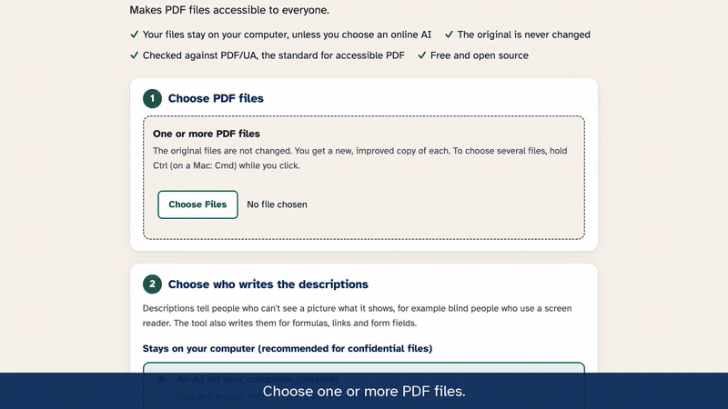
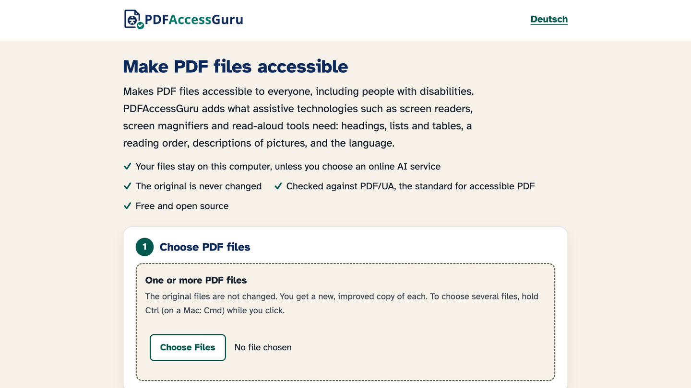
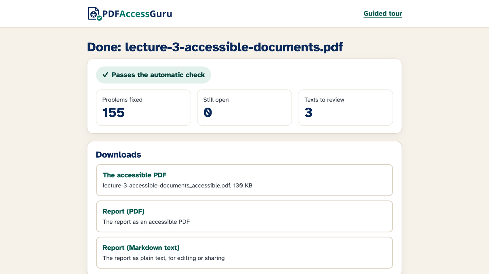
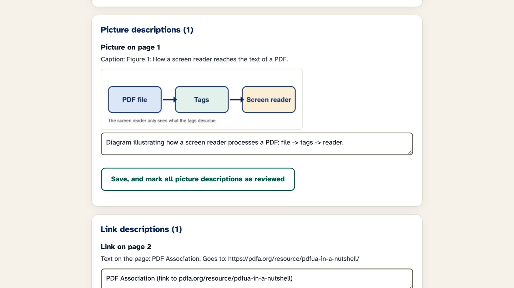
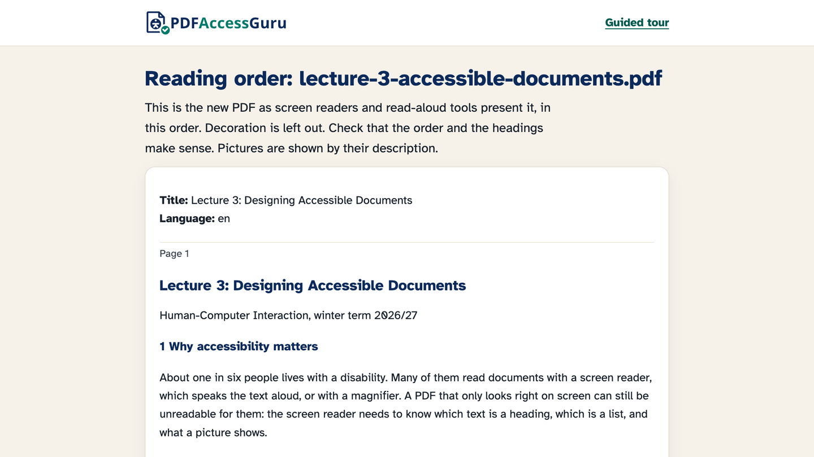

<p align="center">
  
</p>

<p align="center"><strong>Make PDF files accessible to everyone, including people with disabilities.<br>
Free, on your own computer, in a few minutes.</strong></p>

<p align="center">
  <a href="https://pypi.org/project/pdfaccessguru/"></a>
  
  
  
  <a href="LICENSE"></a>
</p>

<p align="center">
  <a href="#install"><strong>Install</strong></a> ·
  <a href="#demo">Demo</a> ·
  <a href="#what-it-does">What it does</a> ·
  <a href="#questions">Questions</a>
</p>

<p align="center">
  <a href="docs/media/demo-short.mp4?raw=true">
    <picture>
      <source media="(prefers-reduced-motion: reduce)" srcset="docs/media/demo-poster.png">
      
    </picture>
  </a>
  <br>
  <strong>Download and watch the demo:</strong>
  <a href="docs/media/demo-short.mp4?raw=true">short, 1 minute (MP4, 1.8 MB)</a> ·
  <a href="docs/media/demo-full.mp4?raw=true">full, 2 minutes, with the guided tour (MP4, 3.6 MB)</a>
</p>

## Why

**Most PDFs shut people out.** In a random sample of 1,000 PDF files from the web (the SafeDocs collection),
627 had no tags at all. Without tags, a screen reader cannot tell a heading from a footnote, reads a table
as a jumble of words, and skips pictures. Fixing this by hand takes hours, often in paid software.

PDFAccessGuru does most of the work for you. For example, a lecture handout from the demo:

| | Before | After |
|---|---|---|
| Problems found by the PDF/UA check (veraPDF) | 155 | 0 |
| Headings, lists, tables and reading order | not marked | tagged |
| Picture and link descriptions | missing | written, ready for you to review |
| Title and language | missing | set |

- **It fixes, not only checks.** Many tools list the problems. PDFAccessGuru repairs them, then checks the result against PDF/UA, the international standard for accessible PDF.
- **Private.** Everything runs on your computer. Even the AI can run on your computer; only if you choose an online AI does anything leave it.
- **Safe.** Your original file is never changed. Every fix is checked and undone if it would make the file worse or change how a page looks.
- **You stay in control.** Review and correct everything the tool decided on its own, and get a report in plain words, in the language of the PDF.
- **Fit for official templates.** Colors stay exactly as they are, unless you switch on the contrast fix.
- **Accessible itself.** Works with a keyboard and with screen readers, in light and dark mode, and starts with a short guided tour.

## Demo

The videos have captions and no sound. Download and watch:
[short demo, 1 minute (MP4, 1.8 MB)](docs/media/demo-short.mp4?raw=true) ·
[full demo, 2 minutes, with the guided tour (MP4, 3.6 MB)](docs/media/demo-full.mp4?raw=true).

| | |
|---|---|
|  |  |
| **Start:** choose your files and options. | **Result:** what was fixed, and the downloads. |
|  |  |
| **Review and correct** what the tool wrote. | **Reading order**, as screen readers present it. |

## Install

You need about 5 minutes and an internet connection. You do not need admin rights or Python.

**Windows:** open "Windows PowerShell" from the Start menu, paste this line and press Enter:

```powershell
powershell -ExecutionPolicy ByPass -c "irm https://raw.githubusercontent.com/NadeenAhmad/PDFAccessGuru/main/code/PDFAccessGuru/installers/install.ps1 | iex"
```

**Mac or Linux:** open "Terminal", paste this line and press Enter:

```sh
curl -LsSf https://raw.githubusercontent.com/NadeenAhmad/PDFAccessGuru/main/code/PDFAccessGuru/installers/install.sh | sh
```

When it says "Done", open **PDFAccessGuru** from the Start menu (Windows), the Applications folder in your home folder (Mac), or your app menu (Linux).
The first time, it asks you to download two free helper programs and a few free fonts (about 77 MB). This happens only once.

## Use

1. Open PDFAccessGuru. It opens in your web browser, but runs only on your computer. The first time, a short guided tour shows the steps; you can skip it and reopen it at any time by selecting **Guided tour** at the top.
2. Choose one or more PDF files.
3. Choose the options. Every option has a short explanation:
   - **Who writes the descriptions:** an AI on your computer or simple rules (nothing leaves your computer), or an online AI like ChatGPT.
   - ** Colors:** "Improve color contrast" makes text that is hard to read a little darker or lighter (WCAG AA). It is off by default because many templates, including official ones, must keep their colors. Text with too little contrast is listed in the report either way.
   - **Report:** You always get a report on the changes. You can add a review list of everything the tool decided on its own.
4. Click **Make the PDF accessible**.
5. Download the new PDF and the report. For several files, everything comes in a single ZIP file.
6. Optional: **review and correct** the text the tool wrote, see what it hid as decoration, and look at the **reading order**. Your corrections go into the new PDF and into the report.

The report says in plain words what was fixed and what you still need to do. It is written in the
language of the PDF: English and German are built in; other languages are translated by the AI.
The app works with a keyboard and screen readers, in both light and dark modes.

In a terminal:

```sh
pdfaccessguru fix your-file.pdf                  # writes your-file_accessible.pdf and a report next to it
pdfaccessguru fix a.pdf b.pdf                    # several files; a folder name fixes every PDF in it
pdfaccessguru fix your-file.pdf --fix-contrast   # also improve color contrast (changes text colors)
pdfaccessguru check your-file.pdf                # only checks, changes nothing
```

## What it does

- **Tags:** files without tags get them (headings, paragraphs, lists, tables, pictures, links, reading order). Headers, footers, and page numbers become decoration.
- **Descriptions:** pictures, formulas, links, and form fields get a description. With an AI, it describes what it sees; without one, it uses the caption or the text in the picture.
- **Language and title:** The document language (also for passages in another language) and a title.
- **Fonts and characters:** Missing fonts are embedded; characters get their text values.
- **Structure repairs:** Lists, tables, headings, table of contents, links, comments, and form fields.
- **Meaning:** It lists what a person should look at, such as link text like "click here", very long picture descriptions, or bullet lines that are not marked as a list.
- **Colour contrast:** Always measured; changed only if you switch it on.
- **Protected files:** With the owner password, it allows screen readers to read the file and keeps the protection.

Every change is checked: if a fix would make the file worse or change how a page looks, it is undone (only the color change you switch on changes colors).
Some things only a person can judge, such as whether a picture description is right; the report lists them.
See [known limits](docs/known-limits.md).

## Optional: texts written by an AI

Without an AI, PDFAccessGuru uses simple rules, and the report says so. With an AI, these texts are usually better:

- **On your own computer (free, private):** install [Ollama](https://ollama.com), then run `ollama pull gemma3:4b`. PDFAccessGuru finds it by itself. Nothing leaves your computer.
- **An online AI like ChatGPT:** put `OPENAI_API_KEY=your-key` (OpenAI) or `OPENROUTER_API_KEY=your-key` (OpenRouter: Claude, Gemini, and others) into the settings file. The app and `pdfaccessguru doctor` show where it is. Pictures and text from your file are then sent to that company. Your key stays in the settings file on your computer: PDFAccessGuru sends it only to that company and never puts it into the PDF or the report.

In the app, only the online AI sends anything over the internet, and it is never chosen for you. In a terminal, `pdfaccessguru fix --local-only FILE` makes sure nothing is sent.

## Questions

**Is it free?** Yes. It is open-source, and the AI on your computer (Ollama) is free, too.

**Are my files uploaded?** No. PDFAccessGuru runs on your computer; the web browser only shows its pages.
Only if you choose an online AI are pictures and text from your file sent to that AI company.

**Is my PDF then fully accessible?** Often it passes the automatic check, but no tool can judge everything:
A person should review the descriptions and the reading order. The app shows you what to review, and the
report lists it.

**Does it change how my pages look?** No. Pages look the same as before. Only the contrast fix, which you
switch on yourself, changes text colors.

**Does it work with scanned PDFs?** A scanned page is only a picture of text. Run text recognition (OCR) first,
for example with the free [OCRmyPDF](https://ocrmypdf.readthedocs.io), then use PDFAccessGuru.

**Which languages?** Any language in the PDF. The report is written in the language of the PDF: English and
German are built in; other languages are translated by the AI.

**Other questions?** Write to [nadeen.fathallah@ki.uni-stuttgart.de](mailto:nadeen.fathallah@ki.uni-stuttgart.de).

## Updates

When a new version exists, the app shows "A new version of PDFAccessGuru is available". Click **Update now**. In a terminal: `pdfaccessguru update`.

## Remove

Run `pdfaccessguru uninstall` in a terminal. Your PDF files and reports are not touched.

## Help and feedback

Run `pdfaccessguru doctor` to see whether everything is installed correctly.
Found a problem or have an idea? [Open an issue](https://github.com/NadeenAhmad/PDFAccessGuru/issues).
Questions and inquiries: [nadeen.fathallah@ki.uni-stuttgart.de](mailto:nadeen.fathallah@ki.uni-stuttgart.de)

## For developers

The code is in [`code/PDFAccessGuru`](code/PDFAccessGuru). See its [README](code/PDFAccessGuru/README.md) for setup and tests.

## Contributors and license

PDFAccessGuru was first built at the University of Stuttgart by Aran Moradi, Babett Ludwig, Brian Karle,
Florian Walcher, Marwa Ayache, Riard Qupevaj, Robin Hart and Siju Li (see [CONTRIBUTORS](CONTRIBUTORS.md)).

Licensed under the [GNU Affero General Public License v3.0](LICENSE).
The app uses the font [Atkinson Hyperlegible](https://www.brailleinstitute.org/freefont/) by the Braille Institute of
America (SIL Open Font License 1.1) and checks files with [veraPDF](https://verapdf.org).

---

<p align="center">If PDFAccessGuru saves you time, please <strong>star this repository</strong>: it helps others find it.<br>
Found a problem or have an idea? <a href="https://github.com/NadeenAhmad/PDFAccessGuru/issues">Open an issue</a>.
Questions and inquiries: <a href="mailto:nadeen.fathallah@ki.uni-stuttgart.de">nadeen.fathallah@ki.uni-stuttgart.de</a></p>
