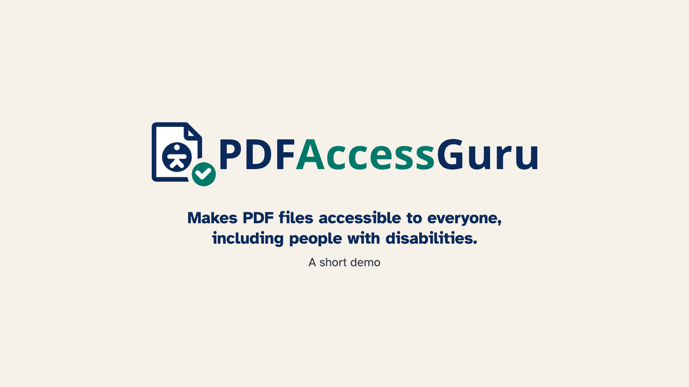

<p align="center">
  
</p>

**PDFAccessGuru makes PDF files accessible to everyone, including people with disabilities.**
It adds what assistive technologies such as screen readers, screen magnifiers and read-aloud tools
need: headings, lists and tables, a reading order, descriptions of pictures and links, and the
language. It checks the result against PDF/UA, the international standard for accessible PDF.

- Runs on your own computer. Your files are not uploaded anywhere, unless you choose an online AI.
- The original file is never changed: you get a new, improved copy.
- Free and open source.

## Demo

[](docs/media/demo-short.mp4)

[Watch the short demo (50 seconds)](docs/media/demo-short.mp4) · [Watch the full demo (2 minutes)](docs/media/demo-full.mp4).
The demo has captions and no sound.

| | |
|---|---|
|  |  |
| **Start:** choose your files and options. | **Result:** what was fixed, and the downloads. |
|  |  |
| **Check and correct** what the tool wrote. | **Reading order**, as screen readers present it. |

## Install

You need about 5 minutes and an internet connection. You do not need admin rights or Python.

**Windows:** open "Windows PowerShell" from the Start menu, paste this line and press Enter:

```powershell
powershell -ExecutionPolicy ByPass -c "irm https://raw.githubusercontent.com/NadeenAhmad/PDFAccessGuru/main/code/PDFAccessGuru/installers/install.ps1 | iex"
```

**Mac or Linux:** open "Terminal", paste this line and press Enter:

```sh
curl -LsSf https://raw.githubusercontent.com/NadeenAhmad/PDFAccessGuru/main/code/PDFAccessGuru/installers/install.sh | sh
```

When it says "Done", open **PDFAccessGuru** from the Start menu (Windows), the Applications folder in your home folder (Mac) or your app menu (Linux).
The first time, it asks to download two free helper programs and a few free fonts (about 77 MB). This happens only once.

## Use

1. Open PDFAccessGuru. It opens in your web browser, but runs only on your computer.
2. Choose one or more PDF files.
3. Choose the options. Every option has a short explanation:
   - **Who writes texts like picture descriptions:** an AI on your computer (free and private), an online AI like ChatGPT, or simple rules.
   - **Colours:** "Improve colour contrast" makes text that is hard to read a little darker or lighter (WCAG AA). It is off by default, because many templates, for example official ones, must keep their colours. Text with too little contrast is listed in the report either way.
   - **Report:** add a list of everything the tool decided by itself, to check it.
4. Click **Make the PDF accessible**.
5. Download the new PDF and the report. With several files, everything comes in one ZIP file.
6. Optional: **check and correct** the texts the tool wrote, see what it hid as decoration, and look at the **reading order**.

The report says in plain words what was fixed and what you still need to do. It is written in the
language of the PDF: English and German are built in; other languages are translated by the AI.
The app works with a keyboard and with screen readers, in light and dark mode.

In a terminal:

```sh
pdfaccessguru fix your-file.pdf                  # writes your-file_accessible.pdf and a report next to it
pdfaccessguru fix a.pdf b.pdf                    # several files; a folder name fixes every PDF in it
pdfaccessguru fix your-file.pdf --fix-contrast   # also improve colour contrast (changes text colours)
pdfaccessguru check your-file.pdf                # only checks, changes nothing
```

## What it does

- **Tags:** files without tags get them (headings, paragraphs, lists, tables, pictures, links, reading order). Headers, footers and page numbers become decoration.
- **Descriptions:** pictures, formulas, links and form fields get a description. With an AI it describes what it sees; without one it uses the caption or the text in the picture.
- **Language and title:** the document language (also for passages in another language) and a title.
- **Fonts and characters:** missing fonts are embedded; characters get their text values.
- **Structure repairs:** lists, tables, headings, table of contents, links, comments and form fields.
- **Meaning:** it lists what a person should look at, such as link texts like "click here", very long picture descriptions, or bullet lines that are not marked as a list.
- **Colour contrast:** always measured; changed only if you switch it on.
- **Protected files:** with the owner password, it allows screen readers to read the file and keeps the protection.

Every change is checked: if a fix would make the file worse or change how a page looks, it is undone (only the colour change you switch on changes colours).
Some things only a person can judge, such as whether a picture description is right; the report lists them.
See [known limits](docs/known-limits.md).

## Optional: texts written by an AI

Without an AI, PDFAccessGuru uses simple rules, and the report says so. With an AI, these texts are usually better:

- **On your own computer (free, private):** install [Ollama](https://ollama.com), then run `ollama pull gemma3:4b`. PDFAccessGuru finds it by itself. Nothing leaves your computer.
- **An online AI like ChatGPT:** put `OPENAI_API_KEY=your-key` (OpenAI) or `OPENROUTER_API_KEY=your-key` (OpenRouter: Claude, Gemini and others) into the settings file. `pdfaccessguru doctor` shows where it is. Pictures and text from your file are then sent to that company.

To make sure nothing is ever sent to the internet, choose "Never send anything from my file to the internet" in the app, or use `pdfaccessguru fix --local-only FILE`.

## Updates

When a new version exists, the app shows "A new version of PDFAccessGuru is available". Click **Update now**. In a terminal: `pdfaccessguru update`.

## Remove

Run `pdfaccessguru uninstall` in a terminal. Your PDF files and reports are not touched.

## Help and feedback

Run `pdfaccessguru doctor` to see whether everything is installed correctly.
Found a problem or have an idea? [Open an issue](https://github.com/NadeenAhmad/PDFAccessGuru/issues).

## For developers

The code is in [`code/PDFAccessGuru`](code/PDFAccessGuru). See its [README](code/PDFAccessGuru/README.md) for setup and tests.

## Contributors and licence

PDFAccessGuru was first built at the University of Stuttgart by Aran Moradi, Babett Ludwig, Brian Karle,
Florian Walcher, Marwa Ayache, Riard Qupevaj, Robin Hart and Siju Li (see [CONTRIBUTORS](CONTRIBUTORS.md)).

Licensed under the [GNU Affero General Public License v3.0](LICENSE).
The app uses the font [Atkinson Hyperlegible](https://www.brailleinstitute.org/freefont/) by the Braille Institute of
America (SIL Open Font License 1.1) and checks files with [veraPDF](https://verapdf.org).
