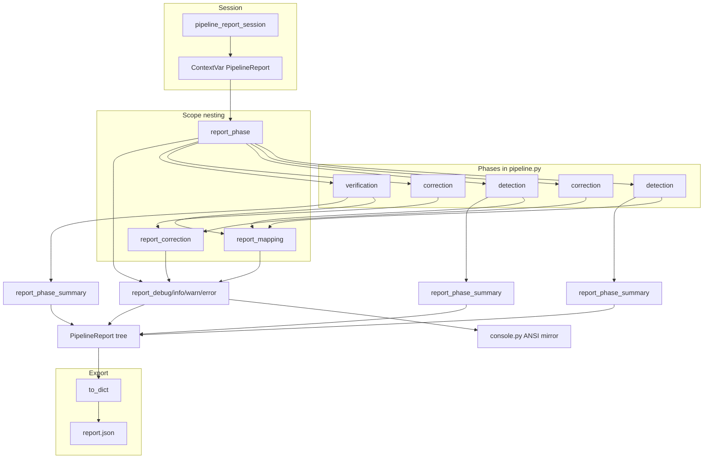

# Architecture

## Pipeline reporting

Each pipeline run builds a structured in-memory report. The mutable tree lives in [`src/pdfaccessguru/model/pipeline_report`](src/pdfaccessguru/model/pipeline_report); the write API is [`src/pdfaccessguru/pipeline/reporting`](src/pdfaccessguru/pipeline/reporting).

- **Model** — dataclass tree with `open_*` / `close_*` / `append` and `to_dict` serialization.
- **Reporting API** — session management via `ContextVar`, scope context managers, message writers, summary builders, and console mirroring.



### Data model

`PipelineReport` holds `phases[]` of `ReportPhase`. Each phase has phase-level `lines[]`, optional `summary`, and nested runs:

- **Detection / verification:** `mappings[]` (`MappingRun`: `violation_id`, `context`, `lines[]`)
- **Correction:** `corrections[]` (`CorrectionRun`: `violation_name`, `affected_element`, `lines[]`)

Messages are `ReportLine` entries (`level`, `message`) with levels from `ReportLevel` (`debug`, `info`, `warn`, `error`).

**PhaseSummary** aggregates violation metrics at the end of detection or verification:

| Field | Detection | Verification |
|-------|-----------|--------------|
| `total_detected_violations` | Count of all detected violations | Count of remaining violations after correction |
| `total_distinct_violations` | Number of distinct violation names | Number of distinct remaining violation names |
| `violation_names` | Sorted list of violation names | Sorted list of remaining violation names |
| `violations_by_name` | Sorted map of name → count | Sorted map of remaining name → count |
| `total_corrected_violations` | — | Detection total minus remaining total |
| `corrected_by_name` | — | Map of name → `ViolationCorrectionSummary` |

`ViolationCorrectionSummary` records per-type correction stats during verification: `corrected_count`, `detected_count` (from the detection phase baseline), and `ratio` (`corrected_count / detected_count`). The baseline is the detection phase summary ([`build_verification_phase_summary`](src/pdfaccessguru/pipeline/reporting/summary.py)). `corrected_by_name` includes every violation type from detection, even types fully corrected and absent from the remaining violations.

**Serialization** (`ReportPhase.to_dict`):

- Always emits `name` and `lines`.
- Emits `mappings` only for detection and verification phases; `corrections` only for the correction phase.
- Emits `summary` when present.
- Omits mapping/correction runs that have zero lines.

### Runtime API

**Session.** [`pipeline.py`](src/pdfaccessguru/pipeline/pipeline.py) wraps a run in `pipeline_report_session` ([`context.py`](src/pdfaccessguru/pipeline/reporting/context.py)). It creates a `PipelineReport`, binds it via a `ContextVar`, and yields an empty dict for the duration of the `with` block. On exit it marks the report finished, serializes `report.to_dict()` into the yielded dict, and resets the context variable. Callers use `get_current_report()`; no report object is threaded through the pipeline.

**Scopes.** [`scopes.py`](src/pdfaccessguru/pipeline/reporting/scopes.py) provides `report_phase`, `report_mapping`, and `report_correction`. Each opens a scope on the report for the `with` block and routes subsequent writes to the active `lines` target:

```python
# detection / verification (inside detect / rerun_detection)
with report_mapping(verapdf_violation): ...

# correction (inside correct)
with report_correction(detected_violation): ...
```

- `report_mapping` takes a `VeraPdfViolation` and records `violation_id` + `context`.
- `report_correction` takes a `DetectedViolation`, records `violation.name`, and derives `affected_element` via `describe_pikepdf_element`.

Typical nesting:

- **Detection / verification:** `report_phase` → `report_mapping` (per veraPDF violation)
- **Correction:** `report_phase` → `report_correction` (per detected violation)

Without an active session, scopes and writers no-op. `report_mapping` is also a no-op unless the current phase is `detection` or `verification`.

**Writers.** [`writer.py`](src/pdfaccessguru/pipeline/reporting/writer.py) exposes `report_debug` / `report_info` / `report_warn` / `report_error` and `report_phase_summary(violations)`. Writers append to the current scope and mirror to the console ([`console.py`](src/pdfaccessguru/pipeline/reporting/console.py), ANSI-colored by level when stdout is a TTY and `NO_COLOR` is unset; message text has no level prefix). `report_phase_summary` calls `PipelineReport.set_phase_summary`, which delegates to [`summary.py`](src/pdfaccessguru/pipeline/reporting/summary.py) to build detection or verification metrics.

**Utility exports.** [`__init__.py`](src/pdfaccessguru/pipeline/reporting/__init__.py) also exports `iter_report_lines` (yield every line in the tree) and `count_reporting_levels` (aggregate level counts for the top-level `reporting` block). Scope managers are imported from `pdfaccessguru.pipeline.reporting.scopes`, not from the package root.

### Pipeline integration

[`pipeline.py`](src/pdfaccessguru/pipeline/pipeline.py) runs detection and correction twice, then verifies:

1. `report_phase("detection")` → [`detect()`](src/pdfaccessguru/pipeline/PDFAccessGuruDetect/detect.py) (each veraPDF violation wrapped in `report_mapping`) → `report_phase_summary(detected_violations)`
2. `report_phase("correction")` → [`correct()`](src/pdfaccessguru/pipeline/PDFAccessGuruCorrect/correct.py) (each violation wrapped in `report_correction`)
3. Save PDF, then `report_phase("detection")` again on the saved file → `report_phase_summary`
4. `report_phase("correction")` again for remaining violations, then save
5. `report_phase("verification")` → `rerun_detection()` (again wrapped in `report_mapping`) → `report_phase_summary(not_corrected_violations)`

Phase names are reused. `open_phase` appends a new entry each time, so the report contains two detection phases and two correction phases. Customer metrics still use the first `"detection"` summary as the baseline and the `"verification"` summary as remaining-after-all-corrections.

The returned dict is the serialized report for the run.

### JSON export

`PipelineReport.to_dict()` returns paths, timestamps, a `reporting` block (level counts via `count_reporting_levels`), and serialized phases. A real export is in [`pdf_cache/report.json`](pdf_cache/report.json).

```json
{
  "pdf_path": "pdf_cache/broken.pdf",
  "output_path": "pdf_cache/output.pdf",
  "started_at": "2026-07-05T19:22:05.051056+00:00",
  "finished_at": "2026-07-05T19:22:14.333272+00:00",
  "reporting": {"debug": 2, "info": 0, "warn": 113, "error": 1},
  "phases": [
    {
      "name": "detection",
      "lines": [{"level": "debug", "message": "Number of detected violations by veraPDF ..."}],
      "mappings": [
        {
          "violation_id": "7.2-20",
          "context": "root/document[0]/StructTreeRoot[0]...",
          "lines": [{"level": "warn", "message": "Manual raise of CouldNotFindAffectedElementException ..."}]
        }
      ],
      "summary": {
        "total_detected_violations": 373,
        "total_distinct_violations": 11,
        "violation_names": ["invalid-annotation", "td-headers-missing", "..."],
        "violations_by_name": {"invalid-annotation": 100, "td-headers-missing": 37}
      }
    },
    {
      "name": "correction",
      "lines": [{"level": "error", "message": "Raised NoCorrectorImplementedException ..."}],
      "corrections": [
        {
          "violation_name": "link-annotation-artifact-not-nested-tag-link",
          "affected_element": "/Annot keys=['/A', '/Rect', ...]",
          "lines": [{"level": "warn", "message": "Manual raise of CouldNotCorrectDetectedViolationException ..."}]
        }
      ]
    },
    {
      "name": "verification",
      "lines": [{"level": "debug", "message": "Number of detected violations by veraPDF ..."}],
      "mappings": [
        {
          "violation_id": "7.2-20",
          "context": "root/document[0]/StructTreeRoot[0]...",
          "lines": [{"level": "warn", "message": "Manual raise of CouldNotFindAffectedElementException ..."}]
        }
      ],
      "summary": {
        "total_detected_violations": 358,
        "total_distinct_violations": 8,
        "violation_names": ["invalid-annotation", "td-headers-missing", "..."],
        "violations_by_name": {"invalid-annotation": 100, "td-headers-missing": 37},
        "total_corrected_violations": 15,
        "corrected_by_name": {
          "id-note-tag-missing": {"corrected_count": 1, "detected_count": 1, "ratio": 1.0},
          "invalid-elements-li": {"corrected_count": 10, "detected_count": 10, "ratio": 1.0},
          "invalid-annotation": {"corrected_count": 0, "detected_count": 100, "ratio": 0.0}
        }
      }
    }
  ]
}
```

## Adding report messages

Import writers from `pdfaccessguru.pipeline.reporting` and scopes from `pdfaccessguru.pipeline.reporting.scopes`:

```python
from pdfaccessguru.pipeline.reporting import report_info, report_warn
from pdfaccessguru.pipeline.reporting.scopes import report_mapping, report_correction
```

Call writers inside an active `pipeline_report_session`. Nest work in `report_mapping` or `report_correction` so messages land in the right run. Call `report_phase_summary(violations)` at the end of detection and verification.

## Adding scopes for new pipeline steps

Add a `@contextmanager` in [`scopes.py`](src/pdfaccessguru/pipeline/reporting/scopes.py):

1. `get_current_report()` — no-op if `None`
2. `report.open_*()` on enter, `report.close_*()` in `finally`
3. Wire in `pipeline.py` (`report_phase`) or under an existing phase (`report_correction`, `report_mapping`)

If the new scope applies only to certain phases, follow the `_MAPPING_PHASES` guard pattern used by `report_mapping`.

Test in [`scopes_test.py`](src/test/pipeline/reporting/scopes_test.py): no-op without a session, expected tree shape with `pipeline_report_session`.
